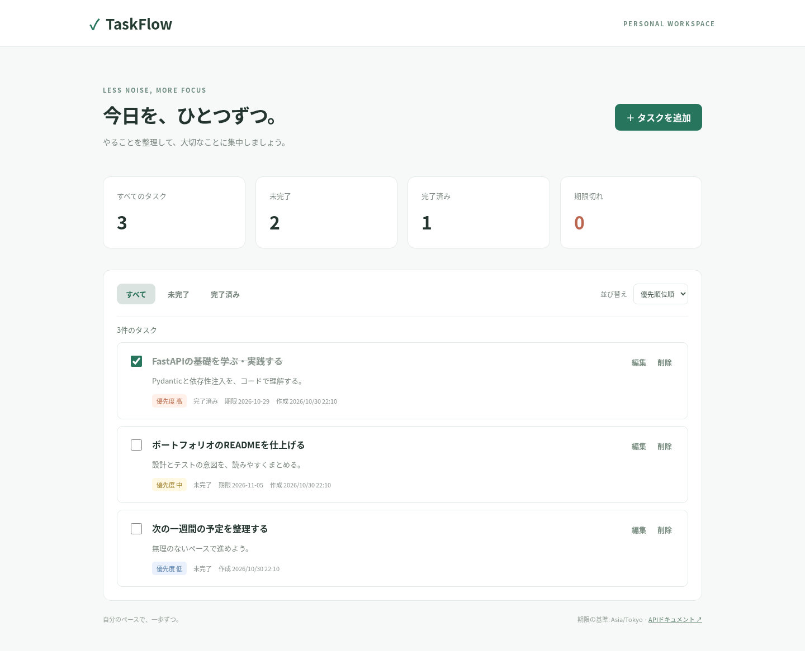
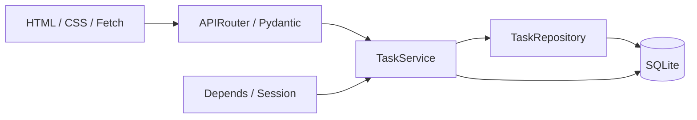
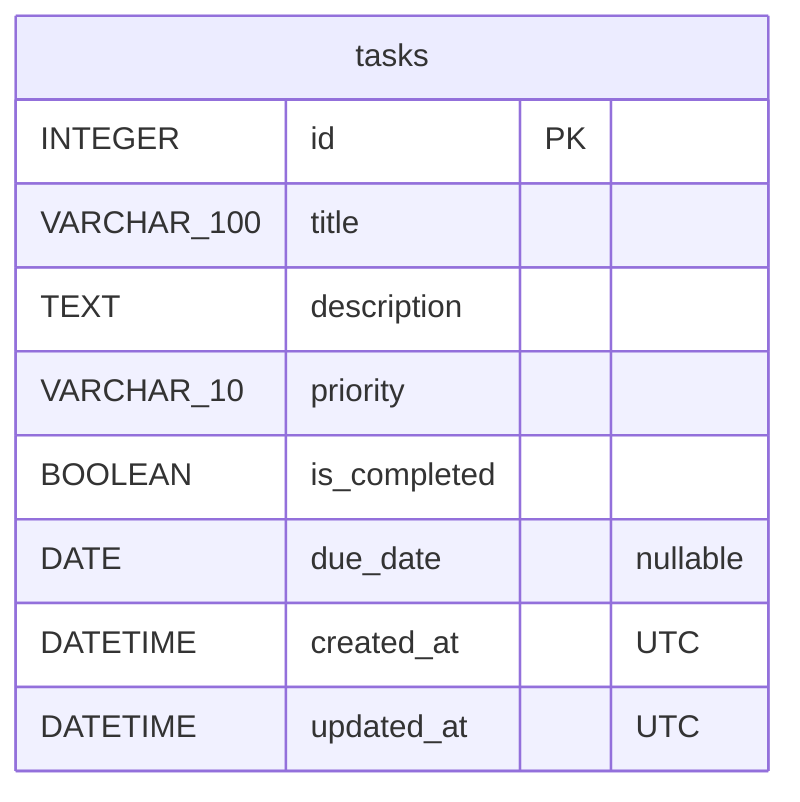

# TaskFlow

Python / FastAPIで作った、個人用の小さなTODO管理アプリです。
CakePHP経験者がPythonの型・バリデーション・ORM・テストを学べるよう、責務を分けた読みやすい構成にしています。認証は未実装です。初期版はローカル専用です。

## 主な機能

- タスクの登録・一覧・詳細API・部分更新・削除確認
- タイトル100文字・詳細1000文字の入力検証
- 優先度（高・中・低）、期限、完了チェック
- 完了状態の絞り込み、作成日時・優先順位・期限での並び替え
- 全件・完了・未完了・期限切れの集計
- レスポンシブな日本語画面、処理中・エラー表示、Swagger UI



[スマートフォン画面](docs/screenshots/mobile.png)

## 技術と選択理由

| 技術 | 用途・理由 |
|---|---|
| Python 3.13 / FastAPI | 型ヒントを使った小さなREST API、OpenAPI自動生成 |
| Pydantic v2 | 作成と部分更新を区別した入力検証 |
| SQLAlchemy 2 / SQLite | 型付きORM、ローカルで完結する永続化 |
| Alembic | DBスキーマの変更履歴 |
| HTML / CSS / Vanilla JS | ビルド不要の画面、Fetch APIによる通信 |
| pytest / HTTPX | 一時SQLiteを使用したAPI・DBテスト |
| Ruff / mypy | コードスタイルと静的型チェック |
| uv / Docker Compose / GitHub Actions | 再現可能な依存関係と実行・検証環境 |

実際の固定バージョンは `uv.lock` と、本番依存のみを出力した `requirements.txt` に記録しています。

## 起動（Docker Desktop + WSL2）

Docker Desktopの Settings → Resources → WSL Integration で利用するディストリビューションを有効にしてください。

```bash
git clone https://github.com/taka26taka/taskflow-fastapi.git
cd taskflow-fastapi
docker compose up --build
```

- Web: http://localhost:8000
- Swagger UI: http://localhost:8000/docs
- Health: http://localhost:8000/health

起動時に `alembic upgrade head` を実行します。DBは `taskflow-data` ボリュームに保存されます。`docker compose down` ではデータは残ります。`docker compose down -v` はデータも削除するため注意してください。
ポートはホストの127.0.0.1にのみ公開します。コンテナは非rootユーザーで実行します。

## ローカルPythonでの開発

[uv公式インストール手順](https://docs.astral.sh/uv/getting-started/installation/)に従ってuvを用意してください。

```bash
uv sync --locked --python 3.13
cp .env.example .env
uv run alembic upgrade head
uv run uvicorn app.main:app --reload --host 127.0.0.1 --port 8000
```

`.env` の `DATABASE_URL` と `APP_TIMEZONE` で設定します。日時はUTC保存、APIは `Z` 付きISO 8601です。
期限は日付で、標準の判定タイムゾーンは `Asia/Tokyo`。当日期限は期限切れに含めず、未完了かつ昨日以前だけが期限切れです。画面の日時表示も日本時間です。`APP_TIMEZONE` を変える場合は画面の表示・説明も合わせて変更してください。

## 検証

```bash
uv run ruff check .
uv run ruff format --check .
uv run mypy app tests
uv run pytest --cov=app --cov-report=term-missing --cov-report=xml
uv run alembic upgrade head
uv run alembic check
uv run pip-audit -r requirements.txt
node --check app/static/js/app.js
```

テストは各fixtureで専用の一時SQLiteファイルを作り、本番DBセッションをDIで置き換えます。最低カバレッジは90%です。
依存更新後は `uv lock`、上記チェックを実行し、以下でDocker用の依存一覧を更新します。

```bash
uv export --no-dev --no-hashes --no-emit-project --format requirements-txt -o requirements.txt
```

## API

| Method | Path | 結果 |
|---|---|---|
| GET | `/api/tasks` | 一覧（200） |
| GET | `/api/tasks/stats` | 全体集計（200） |
| GET | `/api/tasks/{task_id}` | 詳細（200 / 404） |
| POST | `/api/tasks` | 作成（201） |
| PATCH | `/api/tasks/{task_id}` | 部分更新（200 / 404） |
| DELETE | `/api/tasks/{task_id}` | 削除（204 / 404） |
| GET | `/health` | プロセスの生存確認（200、DB疎通は対象外） |

一覧: `?status=all|pending|completed&sort=created_at|priority|due_date`。
優先度は高→中→低、期限は早い順（期限なしは最後）。同順位は作成日時降順、さらにID降順です。
集計はフィルターに関係なく全件を対象にします。
入力不正は422。不明な入力項目も拒否します。PATCHでは省略項目を維持し、`due_date: null` だけを期限解除として許可します。

```bash
curl -X POST http://localhost:8000/api/tasks \
  -H 'Content-Type: application/json' \
  -d '{"title":"FastAPIを学ぶ","priority":"high","due_date":"2026-12-01"}'
```

## アーキテクチャ・構成

```text
taskflow-fastapi/
├── app/
│   ├── main.py                 # アプリ、画面、共通エラー処理
│   ├── api/                   # ルーティングとDI
│   ├── core/config.py         # 環境変数・期限のタイムゾーン
│   ├── db/                    # ORM基底・エンジン・セッション生成
│   ├── models/task.py         # DBモデルと期限切れ判定
│   ├── schemas/task.py        # 入出力型・バリデーション
│   ├── repositories/          # SQLクエリ
│   ├── services/              # 更新処理・commit/rollback
│   ├── static/                # CSS・JavaScript
│   └── templates/index.html   # 静的HTML（テンプレート処理なし）
├── alembic/                   # マイグレーション
├── tests/                     # API・DB・サービス検証
├── docs/                      # 設計・比較・公開手順・検証結果
├── .github/workflows/ci.yml
├── Dockerfile / compose.yaml
└── pyproject.toml / uv.lock / requirements.txt
```





詳細は [設計](docs/architecture.md)、[PHP・Python比較](docs/php-python-comparison.md)を参照してください。

## CI/CD

mainへのpushとPull Requestで、依存インストール、Ruff、mypy、pytestとカバレッジ、Alembic差分検査、依存の脆弱性確認を実行します。カバレッジXMLを成果物として保存します。Docker Composeによる起動とHTTP応答のスモークテストも別ジョブで実行します。自動デプロイはありません。
実行結果は [GitHub Actions](https://github.com/taka26taka/taskflow-fastapi/actions) で確認できます。[ローカル検証記録](docs/verification.md)も参照してください。

## セキュリティ

Pydanticの入力検証、ORMのパラメーター化されたクエリ、DB制約を併用します。
ユーザー入力は `textContent` で表示し、HTMLとして挿入しません。Web画面にはCSPを設定します。SwaggerはFastAPI標準のCDNを利用するため、オフラインでは表示できない場合があります。
CORSミドルウェアは追加せず同一オリジンのみで利用します。エラーには内部例外や入力内容を含めず、アプリ独自の本文ログ出力も行いません。`.env`・SQLite・キャッシュはGit対象外です。

**認証・認可はありません。インターネット公開前には認証・認可またはCloudflare Accessによる制限が必須です。Tunnelだけではアクセス制限になりません。**
[Cloudflare導入手順](docs/cloudflare-deployment.md)は将来向けの文書で、契約・課金・本番環境変更は行っていません。

## 今後の改善候補

認証・ユーザー別の認可、ページネーション、タスク検索、期限通知、アクセシビリティの継続検証。現在はいずれも未実装です。
